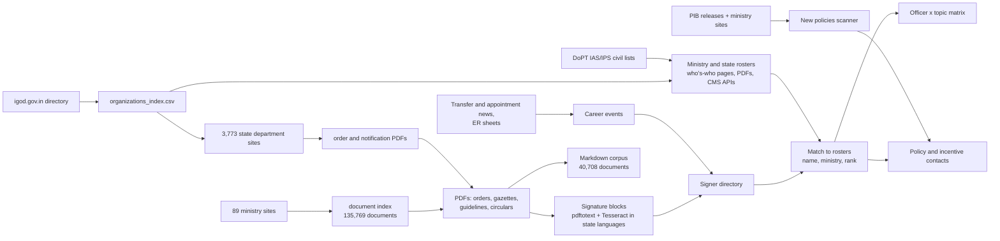

# India Government Yellow Pages

**Who runs what in the Indian government, who signs the orders, and who to contact about a policy or incentive.**

This repository joins four things that are normally scattered across thousands of websites:

1. **Directories** — every government organisation listed on [igod.gov.in](https://igod.gov.in) (union ministries, state departments, judiciary, legislatures, missions), and the officer rosters their own websites publish.
2. **Documents** — an index of ~136,000 orders, notices, guidelines and reports on 89 union-ministry sites, and the text of ~41,000 of them as markdown.
3. **Signatures** — for those documents, *who signed them* (read from the signature block, with OCR in the state's language where the PDF is a scan), matched to the officers in the rosters.
4. **Policies and incentives** — ~720 schemes, PLI programmes, guidelines and notifications, each linked to the officials who signed their paperwork, plus a scan of PIB and ministry sites for what was announced recently.

Everything is built from public government sources and public news. Nothing here is a published helpdesk list: a "contact for a topic" is an inference from the paper trail (see [Methods and limitations](docs/METHODS_AND_LIMITATIONS.md)).

> **New here?** [How to use this repo with AI (Claude, Gemini, ChatGPT)](HOW_TO_USE_WITH_AI.md) — clone it, paste it into an AI tool, and ask in plain English.

## What you can ask it

| Question | Where to look |
|---|---|
| Which officials are listed in a ministry, with phone and email? | `data/ministry_officials.csv` (47 ministries, 10,679 officers) |
| Who is the contact for the ALMM / PM-Surya Ghar / a PLI scheme? | `data/POLICY_CONTACTS.md`, `data/policy_contacts_from_documents.csv` |
| Who signed this notification, and what else have they signed? | `data/signatories/signatory_directory.csv`, `data/signatories/notification_signatories.csv` |
| Which officer handles which topic (HR orders, tenders, RTI, schemes…)? | `data/signatories/officer_topic_matrix.csv` and [`SIGNATORY_MATRIX.md`](data/signatories/SIGNATORY_MATRIX.md) |
| Has that signer moved to another post since? | `moved_since_signing` in the signatory directories, `data/career/career_events.csv` |
| What new schemes and incentives were announced lately, and who administers them? | `data/NEW_POLICIES.md`, `data/new_policies_incentives.csv` |
| What does a state department publish, and who signs for it? | `data/states/<ST>/`, [`data/states/STATE_MATRIX.md`](data/states/STATE_MATRIX.md) |
| Give me the full text of an order | `corpus/md/` ([format](corpus/README.md)), indexed by `data/md_index.csv.gz` |
| Which ministries have no usable directory, and how much is covered? | [`data/RESULTS_SUMMARY.md`](data/RESULTS_SUMMARY.md), [`data/MINISTRY_PLAN.md`](data/MINISTRY_PLAN.md) |

## At a glance (as of 2 Nov 2026)

| Area | Number |
|---|---|
| Government organisations indexed (igod) | 10,718 — union 4,805, state 4,280, judiciary 858, legislatures 435, international 178, apex 162; 36 states and UTs |
| Union-ministry officers with name, designation, phone/email | **10,679** in 47 ministries (7,629 with email) |
| State/UT department officers | **16,228** named officers in 694 departments of all 36 states and UTs (7,742 with email) |
| IAS / IPS civil lists (DoPT) | 5,755 / 4,553 officers with current postings |
| Union ministry document index | 135,769 documents on 89 sites, each with a direct file link |
| Order/notification PDFs read — centre | 24,262; signature block found in 8,224 |
| Order/notification PDFs read — states | 16,446 of 20,608 selected; signature found in 3,444 (930 lines in Indic scripts, romanised and translated) |
| Distinct signers identified | 2,958 (centre) + 2,736 (states) |
| Signed documents matched to a roster officer | 2,305 (centre), 508 (states) |
| Policy/incentive instruments mapped to documents | 718, of which 299 have at least one signing contact (1,227 contact rows, 449 with an email, 309 with a phone) |
| Recent announcements classified (PIB + ministry sites, since 4 Jul 2026) | 282 instruments, 188 new |
| Career events (appointments, transfers, postings) | 7,083 |
| Markdown corpus | **40,708 documents**, 547,273 pages, ~597 million characters |

## Repository map

```
data/                         All tables (CSV) and data/yellowpages.duckdb (same tables in one file)
  organizations_index.csv     igod directory: every listed organisation (10,718)
  org_contacts.csv, officials.csv   igod contact blocks and who's-who
  ministry_officials.csv      union-ministry rosters from the ministries' own sites (10,679)
  ias_officers.csv, ips_officers.csv   DoPT civil lists with current postings
  signatories/                Centre: who signed what -> officer x topic matrix, signer directory
  states/                     36 states/UTs: rosters, per-state signatures, matrices, go_portals.csv
  career/                     Appointment/transfer events and the "where are they now" report
  policy_*.csv, POLICY_CONTACTS.md   Instruments and the people who sign their paperwork
  new_policies_incentives.csv, NEW_POLICIES.md   What was announced recently
  md_index.csv.gz             One row per markdown document (provenance, pages, OCR method)
  results_by_ministry.csv, results_by_state.csv, RESULTS_SUMMARY.md   Coverage tables
corpus/md/                    Markdown text of 40,708 documents, in 109 zip shards (+ README)
ministry_documents/           Document index of 89 union-ministry sites + the extractors
dashboard/index.html          Offline dashboard over the directory tables
scripts/                      Every pipeline stage (see docs/PIPELINES.md)
docs/                         Data dictionary, pipelines, methods; architecture notes
reports/, src/                Earlier outreach drafts and an experimental DDD/LangGraph design
```

## How it fits together



Details of every stage, with commands, run times and operational lessons, are in [`docs/PIPELINES.md`](docs/PIPELINES.md).

## Quick start

```bash
git clone https://github.com/herrrickshaw/india-govt-yellow-pages.git && cd india-govt-yellow-pages
pip install duckdb pandas            # the data are plain CSV; DuckDB is optional but convenient
```

All DuckDB tables load every column as text, so cast numbers (`cast(n_documents as int)`).

```python
import duckdb
c = duckdb.connect("data/yellowpages.duckdb", read_only=True)

# Who signs most documents at MNRE, and how do I reach them?
c.sql("""select signatory, designations, cast(n_documents as int) docs, email
         from signatory_directory where ministry like 'New and Renewable%'
         order by docs desc limit 10""").show()

# Contacts for an incentive (reads a CSV that is not in the .duckdb file)
c.sql("""select instrument, contact, designation, email
         from read_csv_auto('data/policy_contacts_from_documents.csv')
         where instrument ilike '%ALMM%' and evidence = 'signed documents'""").show()

# New schemes announced recently
c.sql("""select date, ministry, instrument, type, status
         from read_csv_auto('data/new_policies_incentives.csv')
         where is_instrument and new_or_update = 'new' order by date desc limit 10""").show()

# How many officers per state have we found?
c.sql("""select state, count(*) officers from state_officials
         where name is not null and trim(name) <> '' group by 1 order by 2 desc""").show()
```

Read a document's full text:

```python
import zipfile, json
z = zipfile.ZipFile("corpus/md/data__states__TN__pdf/data__states__TN__pdf-001.md.zip")
rows = [json.loads(l) for l in z.read("index.jsonl").decode().splitlines()]
print(rows[0]["title"], rows[0]["source_url"]); print(z.read(rows[0]["doc_id"] + ".md").decode()[:600])
```

Browse visually: open `dashboard/index.html` in a browser (offline, light/dark aware).

## Datasets

[`docs/DATA_DICTIONARY.md`](docs/DATA_DICTIONARY.md) describes every table and column. In short:

| Layer | Files | What it is |
|---|---|---|
| Directory | `organizations_index`, `org_contacts`, `officials` | What igod lists and the contact blocks it publishes |
| Rosters | `ministry_officials`, `states/state_officials`, `ias_officers`, `ips_officers` | People with designations, divisions, phones, emails, from ministries' own pages and DoPT |
| Documents | `ministry_documents/data/all_documents.csv.gz`, `md_index.csv.gz`, `corpus/md/` | What was published, with links, and the converted text |
| Signatures | `signatories/*`, `states/*` | Who signed, matched to rosters, grouped by topic |
| Policies | `policy_*`, `new_policies_*`, `discovered_instruments.csv` | Schemes and incentives and who stands behind them |
| People over time | `career/career_events.csv` | Appointments and transfers from ER sheets and news |
| Coverage | `results_by_*`, `RESULTS_SUMMARY.md`, `MINISTRY_PLAN.md` | What is and is not covered, per ministry and state |

## Coverage and honesty about gaps

- **Rosters decide how much you can match.** Union ministries with a usable who's-who page are covered (47). The other ministries' signers are found but mostly cannot be tied to a named roster entry. Most state-order signers are secretariat-service officers who appear in no roster, so only about 15% of signed state documents (508 of 3,444) match an officer.
- **State coverage is a sample**, not the full output of each state: up to 300 + 400 order PDFs per state, chosen from the pages the crawl reached. State "GO portals" (Shasanadesh, Maharashtra GR, AP/TS GOIR) have search forms that still need dedicated extractors; see `data/states/go_portals.csv`.
- **Scans.** About a third of the converted documents (13,668 of 40,708) needed OCR; 332 (0.8%) still have no text (image-only or unreadable) and are flagged `needs_ocr`. OCR is capped at 10 pages per document.
- **Names are matched, not verified.** Match quality is graded (`high` / `medium` / `low`); two-token common names are the main risk. `moved_since_signing` is a lead to verify, not a fact.
- **Snapshots.** The directories are a point-in-time capture (Oct–Nov 2026). Officers move, and websites change.

The full list of known limitations and how confidence is assigned is in [`docs/METHODS_AND_LIMITATIONS.md`](docs/METHODS_AND_LIMITATIONS.md).

## Responsible use

All inputs are public: government websites and PDFs, DoPT's published civil lists, PIB, and public news. Even so, this repository concentrates the names, official phone numbers and email addresses of public servants, and `ias_officers.csv` / `ips_officers.csv` carry additional personal fields from DoPT's public lists (for example date of birth and domicile).

- Use official email/phone for official queries about policy and incentives; do not use the data for bulk marketing, harassment or profiling.
- Treat a "contact for a topic" as a starting point for a polite enquiry, and check the current post before relying on it.
- Source sites were read at about one request per second per host, robots files respected, and any CAPTCHA, WAF or login wall was treated as a stop sign, not bypassed.
- If you are a listed official and want an entry corrected or removed, open an issue.

## Reproducing and refreshing

The monthly refresh (`scripts/refresh.sh`) rebuilds the igod directory, rosters and DuckDB file. The heavy stages — reading tens of thousands of PDFs with OCR — are separate and documented with costs in [`docs/PIPELINES.md`](docs/PIPELINES.md): the markdown conversion of all 109 shards took about 14 hours on one 8-core AWS machine plus an idle laptop, for roughly $4 of cloud compute. The large raw inputs (the PDFs themselves) are not in git; the `data/archive_manifest.csv` file lists them, and they are kept in a cloud archive.

## Documentation index

| Document | Contents |
|---|---|
| [`docs/DATA_DICTIONARY.md`](docs/DATA_DICTIONARY.md) | Every table: purpose, size, key columns and what they mean |
| [`docs/PIPELINES.md`](docs/PIPELINES.md) | Each pipeline stage, commands, runtimes, costs, operational lessons |
| [`docs/METHODS_AND_LIMITATIONS.md`](docs/METHODS_AND_LIMITATIONS.md) | How signers, matches, topics, instruments and career moves are determined; accuracy and limits |
| [`corpus/README.md`](corpus/README.md) | The markdown corpus format |
| [`ministry_documents/README.md`](ministry_documents/README.md) | The ministry document index and how each site type is crawled |
| [`data/RESULTS_SUMMARY.md`](data/RESULTS_SUMMARY.md) | Per-ministry and per-state results tables |
| [`data/MINISTRY_PLAN.md`](data/MINISTRY_PLAN.md) | Coverage gaps and the plan to close them |
| [`HOW_TO_USE_WITH_AI.md`](HOW_TO_USE_WITH_AI.md) | Using the repository with an AI assistant |
| [`docs/ARCHITECTURE.md`](docs/ARCHITECTURE.md), [`docs/AI_GOVT_AFFAIRS_ANALYSIS.md`](docs/AI_GOVT_AFFAIRS_ANALYSIS.md) | Earlier design notes (DDD/LangGraph sketch; fit with a government-affairs stack) |

## Sources

igod.gov.in (NIC/MeitY) · ministry and department websites (89 union, 3,773 state) · DoPT civil lists and ER sheets · PIB press releases · egazette.gov.in · public news on appointments and transfers (Whispers in the Corridors, PSU Watch, Sarkari Mirror). Language packs used for OCR: Hindi, Marathi, Gujarati, Punjabi, Bengali, Assamese, Odia, Tamil, Telugu, Kannada, Malayalam, Urdu, Nepali.

## Licence

- **Code** (`scripts/`, `src/`, `ministry_documents/tools/`): [MIT](LICENSE).
- **Compiled data and documentation** (`data/`, `docs/`, READMEs, reports, dashboard): [CC BY 4.0](LICENSE-DATA.md) — please credit "India Government Yellow Pages (herrrickshaw/india-govt-yellow-pages)".
- **Not covered:** the source government documents and their converted text (`corpus/md/`) and file listings (`ministry_documents/`) remain the property of the publishing authorities and are linked to via `source_url`; personal data about public servants carries no extra rights from these licences (see [`LICENSE-DATA.md`](LICENSE-DATA.md) and the *Responsible use* section above).
